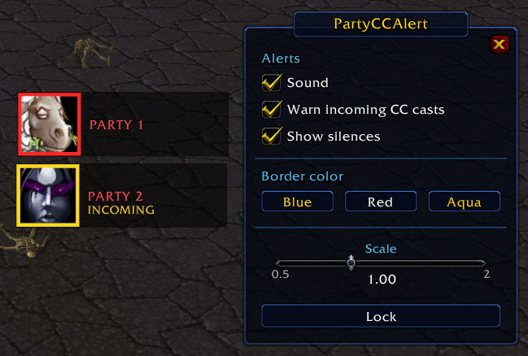

# PartyCCAlert

[English](README.md)

Una alerta grande en el centro de la pantalla cuando **party1** o **party2** están bajo CC en World of Warcraft 3.3.5a (WotLK), con el icono del CC, cuál miembro del grupo es y cuánto le queda.

También avisa **antes** de que llegue el CC: cuando un enemigo le está casteando Miedo, Seducción, Polimorfia, Ciclón y hechizos parecidos a un miembro del grupo, la alerta aparece en amarillo con **INCOMING** y la cuenta regresiva del casteo.

## Funciones

- Alertas de stuns, miedos, incapacitaciones, desorientaciones y silencios (sin raíces ni desarmes).
- Aviso de CC entrante para los CC con casteo: Miedo, Seducción, Polimorfia, Maleficio, Ciclón, Hibernar, Desterrar, Control mental, Expulsar al mal, Encadenar no-muerto y Asustar bestia.
- Si hay más de un CC muestra el más fuerte, con espiral de cooldown y cuenta regresiva.
- Sonido al aparecer la alerta (opcional).
- Se pueden cambiar el color del borde, la escala y la letra del contador.
- Alertas movibles, una por miembro del grupo.
- Funciona en cualquier idioma del cliente.

## Instalación

1. Descargá este repositorio (**Code → Download ZIP**).
2. Copiá la carpeta `PartyCCAlert` en `World of Warcraft/Interface/AddOns/`.
3. Verificá que **PartyCCAlert** esté activado en la lista de AddOns de la pantalla de personajes.

## Uso

Escribí `/pcc` para abrir las opciones.

- **Test / Move** muestra las dos alertas para que las arrastres. Al cerrar la ventana quedan fijas.
- **Timer font** va cambiando la letra del contador.

Los casteos entrantes solo se pueden leer de enemigos que el juego te da como unidad: tu objetivo, tu focus, el mouseover, los objetivos de tu grupo, y los enemigos de arena y sus mascotas.

## Requisitos

- WotLK 3.3.5a (Interface `30300`)

## Créditos

Hecho por **Nidhaus**.
