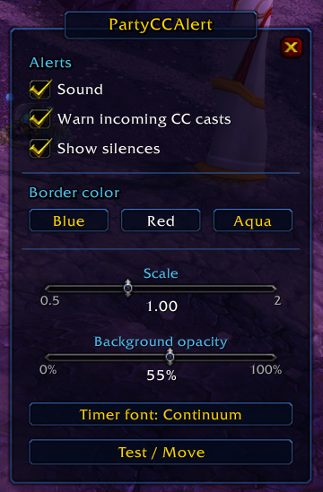

# PartyCCAlert

[Español](README.es.md)

A big alert in the middle of the screen when **party1** or **party2** is crowd-controlled in World of Warcraft 3.3.5a (WotLK), with the CC icon, which party member it is and how long it lasts.

It also warns you **before** the CC lands: when an enemy is casting Fear, Seduction, Polymorph, Cyclone and similar spells on a party member, the alert shows up in yellow with **INCOMING** and the cast countdown.

## Features

- Alerts for stuns, fears, incapacitates, disorients and silences (no roots or disarms).
- Incoming CC warning for cast-time CCs: Fear, Seduction, Polymorph, Hex, Cyclone, Hibernate, Banish, Mind Control, Turn Evil, Shackle Undead and Scare Beast.
- Shows the strongest CC when there is more than one, with a cooldown spiral and countdown.
- Sound when an alert appears (optional).
- Border color, scale, background opacity and countdown font can be changed.
- Movable alerts, one per party member.
- Works in any client language.

## Installation

1. Download **PartyCCAlert.zip** from [Releases](https://github.com/nidas-wow-oss/PartyCCAlert/releases/latest).
2. Extract it into `World of Warcraft/Interface/AddOns/` (you get a `PartyCCAlert` folder).
3. Make sure **PartyCCAlert** is enabled in the AddOns list on the character select screen.

If you use **Code → Download ZIP** instead, rename the folder from `PartyCCAlert-main` to `PartyCCAlert`.

## Usage

Type `/pcc` to open the options.

- **Test / Move** shows both alerts so you can drag them. Closing the window locks them in place.
- **Timer font** cycles through the countdown fonts.

Incoming casts can only be read from enemies the client gives you a unit for: your target, focus, mouseover, your party members' targets, and arena enemies and their pets.

## Requirements

- WotLK 3.3.5a (Interface `30300`)

## Credits

Made by **Nidhaus**.
